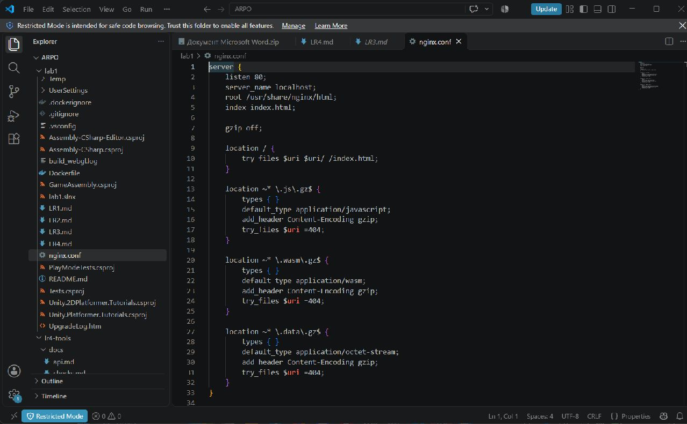
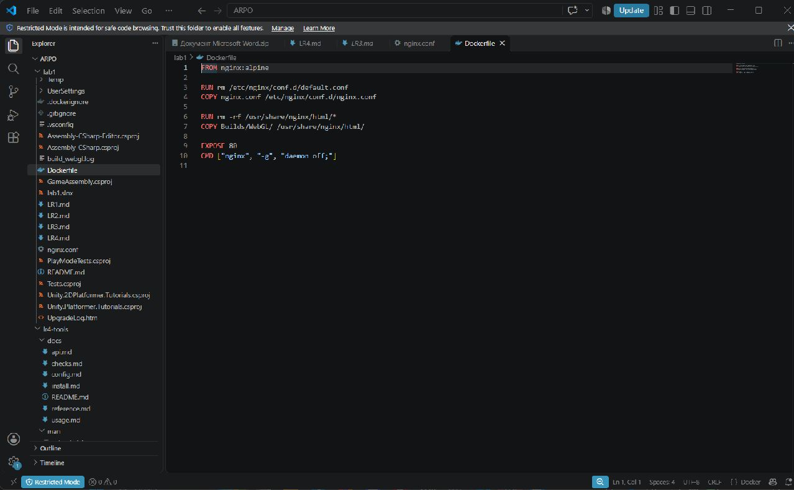

Лабораторная 3

Шаг 1: Настройка сжатия и пересборка WebGL

Включено сжатие Gzip, Decompression Fallback отключен. После пересборки получены файлы .framework.js.gz, .wasm.gz и .data.gz.

Шаг 2: Настройка Nginx

В [nginx.conf](nginx.conf) добавлены Content-Encoding: gzip и нужные Content-Type для JavaScript, WebAssembly и данных игры.



Шаг 3: Создание Dockerfile

В [Dockerfile](Dockerfile) использован nginx:alpine. Конфигурация Nginx заменена, сборка игры скопирована в /usr/share/nginx/html/.



Шаг 4: Локальная проверка

```powershell
docker build -t platformer-compressed:v1 .
docker run -d -p 8080:80 --name unity_compressed_container platformer-compressed:v1
```

Игра запущена на http://localhost:8080. В DevTools у WebGL.wasm.gz проверены 200 OK, Content-Encoding: gzip и Content-Type: application/wasm.


Шаг 5: Настройка пайплайна

В [пайплайн](.github/workflows/main.yaml) добавлена задача build_docker_image: проверка Nginx и сборка образа с публикацией в GHCR. В облаке используются временные Gzip-заглушки.

Шаг 6: Публикация образа

Образ ghcr.io/andr1ch/platformer-game опубликован с тегами latest и SHA коммита.

Шаг 7: Проверка результатов

Все три задачи завершились успешно: sanity_check, mirror_repo и build_docker_image.


