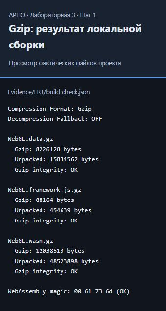
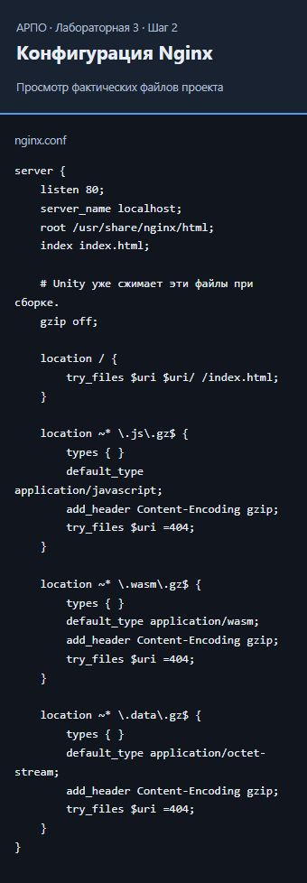
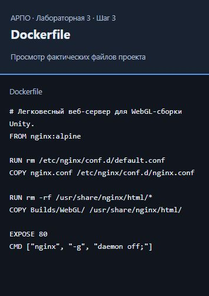
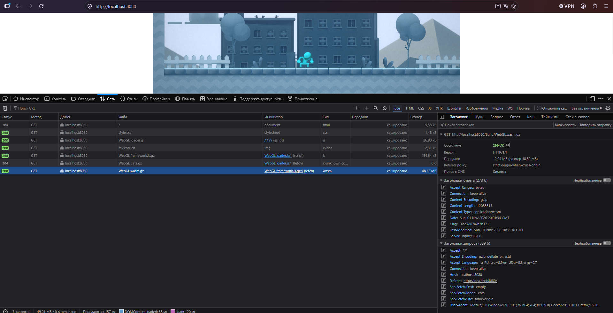
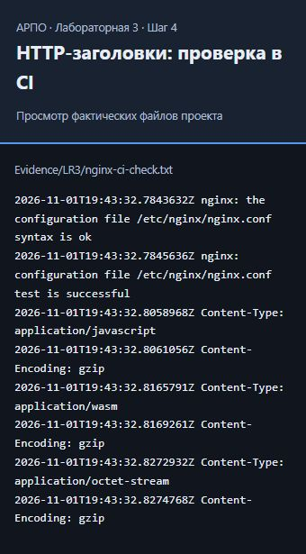
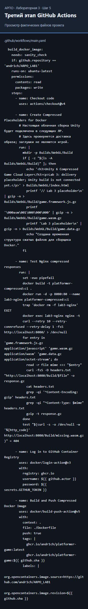
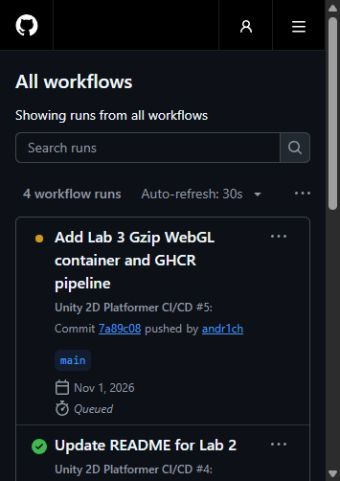
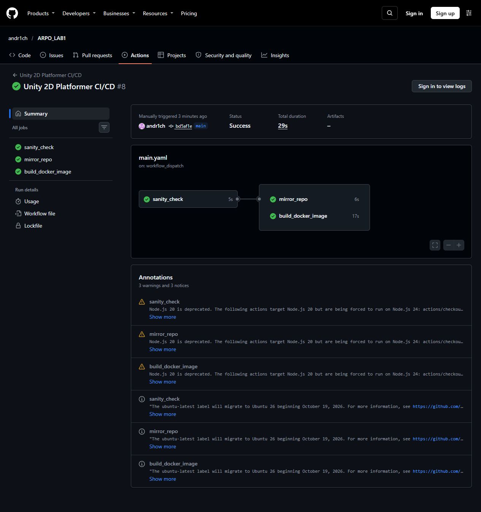

Лабораторная 3

Шаг 1: Настройка Gzip и пересборка WebGL-проекта

В Unity 6 выбран Compression Format — Gzip, Decompression Fallback отключен. Пересборка выполнена через Unity CLI вызовом существующего BuildManager.BuildWebGL(). В Builds/WebGL/Build созданы WebGL.framework.js.gz, WebGL.wasm.gz и WebGL.data.gz.

Проверена целостность всех трех Gzip-архивов и сигнатура WebAssembly. [Результаты проверки локальной сборки](Evidence/LR3/build-check.json). Ниже показан просмотр сохраненных результатов проверки; скриншоты файлов в следующих шагах также сделаны через локальный просмотрщик фактического содержимого.



Шаг 2: Создание конфигурации веб-сервера nginx.conf

Добавлены правила Content-Encoding: gzip и типы application/javascript, application/wasm и application/octet-stream. Отсутствующие архивы возвращают 404.



Шаг 3: Создание Dockerfile

Использован nginx:alpine. Стандартная конфигурация заменена на nginx.conf, файлы игры копируются в /usr/share/nginx/html/. Контейнер слушает порт 80. В .dockerignore оставлены только необходимые файлы сборки.



Шаг 4: Локальное тестирование контейнера

Собран локальный образ platformer-compressed:v1 с настоящей WebGL-игрой. Контейнер unity_compressed_container запущен с пробросом порта 8080:80, игра успешно загрузилась в браузере по адресу http://localhost:8080.

В Firefox DevTools → Сеть выбран файл WebGL.wasm.gz. Подтверждены статус 200 OK и заголовки ответа Content-Encoding: gzip, Content-Type: application/wasm. Передано 12,04 МБ при размере распакованного WebAssembly 48,52 МБ. [Заголовки локального Nginx](Evidence/LR3/local-http-headers.txt).



Та же конфигурация проверена в настоящем Docker-контейнере на GitHub Actions с облачными Gzip-заглушками. Успешно выполнены nginx -t, проверка Content-Type и Content-Encoding для трех типов архивов, gzip -t и проверка ответа 404 для отсутствующего архива. [Фактические заголовки из CI](Evidence/LR3/nginx-ci-check.txt).



Команды локальной сборки и запуска:

```powershell
docker build -t platformer-compressed:v1 .
docker run -d -p 8080:80 --name unity_compressed_container platformer-compressed:v1
```

После проверки тестовый контейнер остановлен и удален:

```powershell
docker stop unity_compressed_container
docker rm unity_compressed_container
```

Шаг 5: Модернизация облачного пайплайна

В существующий .github/workflows/main.yaml добавлена третья задача build_docker_image. Задачи sanity_check и mirror_repo сохранены. Для публикации предоставлено packages: write, вход в GHCR выполняется через системный GITHUB_TOKEN.

В облаке временно создаются Gzip-заглушки, поскольку Builds/ исключена из Git. Облачный образ этой лабораторной проверяет доставку контейнера и не содержит скомпилированную игру. Локальный образ собирается с настоящей WebGL-игрой.



Шаг 6: Отправка изменений в GitHub

Файлы отправлены в main репозитория [andr1ch/ARPO_LAB1](https://github.com/andr1ch/ARPO_LAB1). В проверенном запуске образ опубликован с тегами ghcr.io/andr1ch/platformer-game:latest и ghcr.io/andr1ch/platformer-game:bd5af1ee099dfd342cbf2e273a6862cd192e438a.



Шаг 7: Проверка результатов и оформление отчета

Отчеты первых двух лабораторных перенесены из README.md в LR1.md и LR2.md с сохранением скриншотов. В README.md добавлена таблица ссылок на три работы.

В [проверенном запуске Actions](https://github.com/andr1ch/ARPO_LAB1/actions/runs/41344578516) все три задачи — sanity_check, mirror_repo и build_docker_image — завершились успешно. Общий статус Success. Проверки Nginx и публикация образа выполнены в [Docker-задаче](https://github.com/andr1ch/ARPO_LAB1/actions/runs/41344578516/job/124961606104). [Результаты всех задач](Evidence/LR3/actions-check.json).



Локальный запуск настоящей игры, раздача Gzip-архивов и облачный пайплайн проверены. Ссылку на репозиторий в Google Classroom отправляет студент.

Контрольные вопросы

1. Content-Encoding: gzip сообщает браузеру, что тело ответа нужно распаковать перед выполнением JavaScript или WebAssembly. Тип содержимого задается отдельно через Content-Type.
2. Заглушки нужны, чтобы COPY Builds/WebGL/ в Dockerfile работала на GitHub Actions до подключения облачной сборки Unity. Здесь вместо пустых файлов созданы корректные Gzip-архивы.
3. Файлы игры копируются в /usr/share/nginx/html/.
4. latest указывает на последнюю опубликованную версию, а тег SHA фиксирует конкретную ревизию для воспроизводимости и отката.
