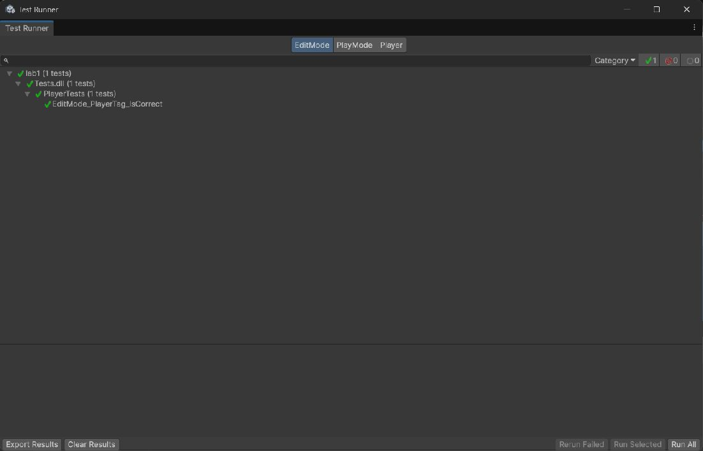
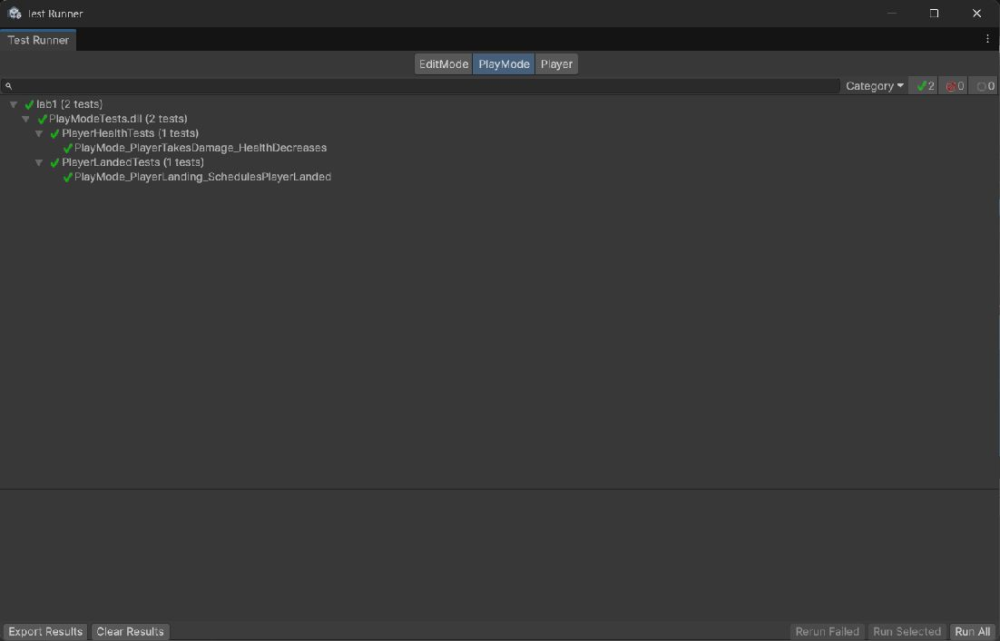
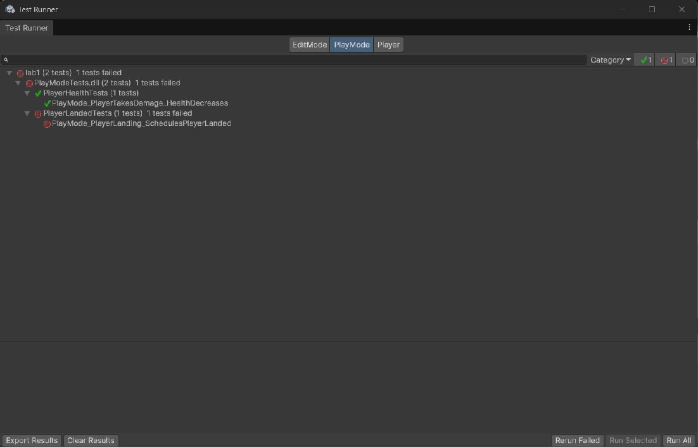

Лабораторная 4. Вариант 10

Шаг 1: Подготовка тестов

Игровой код вынесен в [GameAssembly](Assets/Scripts/GameAssembly.asmdef). В Assets/Tests созданы отдельные сборки EditMode и PlayMode.

Шаг 2: Базовые тесты

[PlayerTests.cs](Assets/Tests/EditMode/PlayerTests.cs) проверяет тег и компоненты игрока на сцене. [PlayerHealthTests.cs](Assets/Tests/PlayMode/PlayerHealthTests.cs) проверяет получение урона.

Шаг 3: Вариант 10 — приземление

[PlayerLandedTests.cs](Assets/Tests/PlayMode/PlayerLandedTests.cs) проверяет падение игрока на платформу: событие PlayerLanded должно появиться один раз после приземления.

Все три локальных теста проходят: EditMode — 1/1, PlayMode — 2/2.

Шаг 4: Настройка пайплайна

В [пайплайн](.github/workflows/main.yaml) добавлен запуск тестов. Docker и зеркалирование запускаются только после их успешного прохождения. Результаты сохраняются в артефакт test-results.

Шаг 5: Проверка ошибки

При временном отключении события приземления тест падает. После восстановления кода снова проходит.

Облачный запуск завершился успешно: тесты пройдены, зеркалирование выполнено, Docker-образ собран и опубликован.
