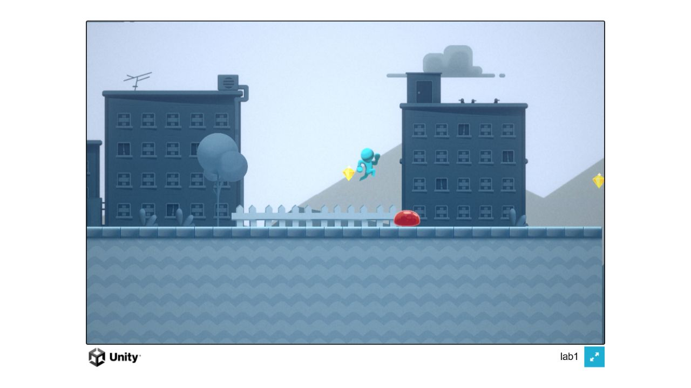
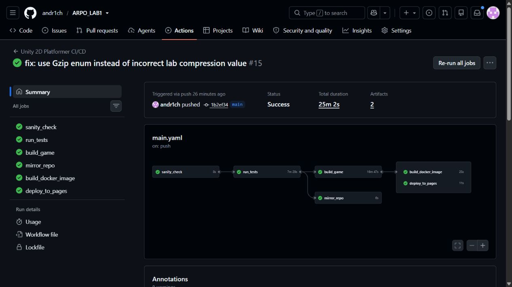
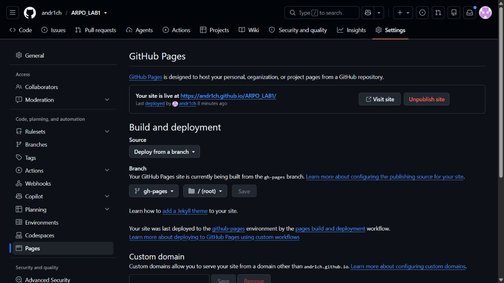
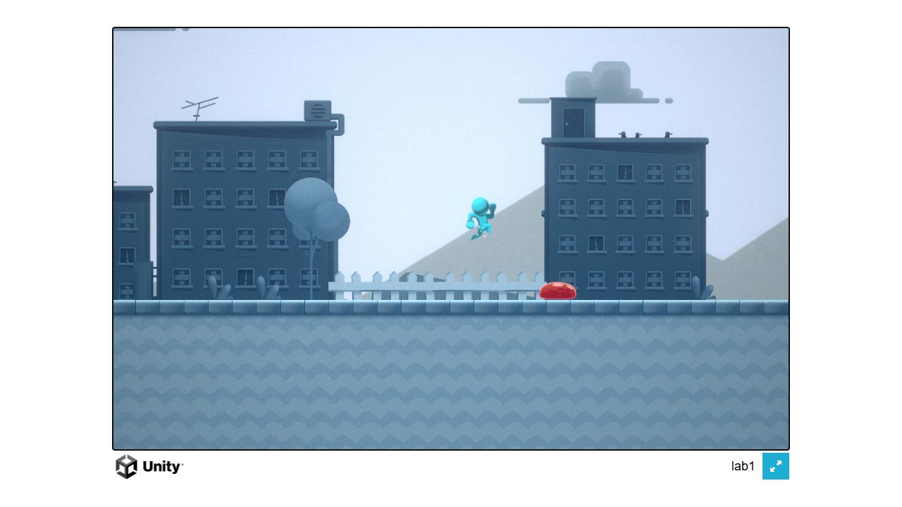

# Лабораторная работа №5

Автоматическая компиляция WebGL-игры в облаке и деплой на GitHub Pages.

## Шаг 1. Настройка WebGL

В [ProjectSettings.asset](ProjectSettings/ProjectSettings.asset) включены Gzip (`webGLCompressionFormat: 1`) и Decompression Fallback (`webGLDecompressionFallback: 1`). Эти же параметры явно задаёт `BuildManager.BuildWebGL`. Fallback нужен для GitHub Pages, где нельзя настроить заголовок `Content-Encoding` для файлов игры.

В методичке есть опечатка: значение `0` соответствует Brotli, а Gzip — значению `1`. Это подтверждает [исходный код Unity](https://github.com/Unity-Technologies/UnityCsReference/blob/master/Editor/Mono/PlayerSettingsWebGL.bindings.cs). В работе выбран требуемый Gzip.

В Unity 6 при включённом fallback сжатые файлы получают расширение `.unityweb`, а не `.gz`. Поэтому [Nginx](nginx.conf) поддерживает оба расширения: JavaScript получает `application/javascript`, WebAssembly — `application/wasm`, данные — `application/octet-stream`; для всех трёх типов добавляется `Content-Encoding: gzip`.

Используется Unity `6000.3.10f1`, установленная для этого проекта. Эта версия явно указана и для тестов, и для сборки; `ProjectVersion.txt` по-прежнему исключён из Git.

## Шаг 2. Облачная сборка

В [пайплайн](.github/workflows/main.yaml) добавлена задача `build_game` с `needs: run_tests`. После успешных EditMode- и PlayMode-тестов `game-ci/unity-builder@v4` вызывает существующий метод [BuildManager.BuildWebGL](Assets/Editor/BuildManager.cs) из ЛР №1. Он собирает включённые сцены в `Builds/WebGL`, выводит время и размер сборки и возвращает код завершения через `EditorApplication.Exit`.

Для ускорения повторных сборок кэшируется `Library`. Лицензия берётся из секретов `UNITY_LICENSE`, `UNITY_EMAIL`, `UNITY_PASSWORD`.

После сборки проверяются непустой `index.html`, загрузчик и три Gzip-файла `.framework.js.unityweb`, `.wasm.unityweb`, `.data.unityweb`. Результат сохраняется в артефакт `WebGL-Build`. Каталог `Builds` остаётся в `.gitignore`.

## Шаг 3. Docker и GitHub Pages

Генерация заглушек удалена. Задачи `build_docker_image` и `deploy_to_pages` зависят от `build_game` и скачивают один и тот же артефакт в `Builds/WebGL`.

Docker-задача проверяет конфигурацию Nginx, доступность страницы, MIME-типы и Gzip-заголовки реальных файлов игры, целостность сжатых ответов и ответ 404 для отсутствующего файла. Затем образ публикуется в GHCR с тегами `latest` и SHA коммита.

Задача `deploy_to_pages` с помощью `JamesIves/github-pages-deploy-action@v4` публикует игру в ветку `gh-pages`. Для сайта требуется источник Pages `Deploy from a branch`, ветка `gh-pages`, каталог `/`.

Зеркалирование из ЛР №2 сохранено и, как раньше, запускается после успешных тестов.

## Шаг 4. Проверка результата

Проверка `actionlint` пройдена. В GitHub Actions прошли все тесты из ЛР №4: EditMode — 1/1, PlayMode — 2/2.

Локальный вызов `BuildManager.BuildWebGL` завершился успешно. Повторная сборка с прогретым кэшем заняла 17,03 секунды по отчёту Unity, размер — 20 423 087 байт. Все три файла `.unityweb` распакованы как Gzip; распакованный `.wasm` содержит сигнатуру WebAssembly.

```powershell
docker build -t platformer-lr5:local .
docker run -d -p 8080:80 --name arpo-lr5-local platformer-lr5:local
```

В контейнере прошёл `nginx -t`. Страница и три файла сборки вернули HTTP 200. Для JavaScript, WebAssembly и данных проверены соответствующие `Content-Type` и `Content-Encoding: gzip`. Отсутствующий файл возвращает 404.

В браузере на `http://localhost:8080/` проверены движение стрелками, прыжок пробелом и сбор кристалла. Ошибок в консоли нет.



## Шаг 5. Облачная публикация

[Прогон №15](https://github.com/andr1ch/ARPO_LAB1/actions/runs/44580795462) завершился успешно за 25 минут 2 секунды. Все шесть задач зелёные: `sanity_check`, `run_tests`, `build_game`, `mirror_repo`, `build_docker_image`, `deploy_to_pages`.



В логе облачной сборки присутствует результат существующего метода из ЛР №1:

```text
[CI/CD] УСПЕХ! WebGL-билд успешно создан.
[CI/CD] Время сборки: 679.22 сек. Размер: 23243195 байт.
```

Артефакт `WebGL-Build` скачан и проверен. В нём находятся `index.html`, загрузчик, каталоги `Build`, `StreamingAssets`, `TemplateData` и настоящие сжатые ресурсы игры:

| Файл | Размер, байт | Проверка |
|---|---:|---|
| `WebGL.framework.js.unityweb` | 92 699 | Gzip, распаковка успешна |
| `WebGL.wasm.unityweb` | 14 149 313 | Gzip, сигнатура WebAssembly корректна |
| `WebGL.data.unityweb` | 8 932 380 | Gzip, распаковка успешна |

GitHub Pages включён с источником `Deploy from a branch`, веткой `gh-pages` и каталогом `/`. Отдельный запуск `pages build and deployment` также завершился успешно. Адрес игры: [andr1ch.github.io/ARPO_LAB1](https://andr1ch.github.io/ARPO_LAB1/).



При повторной проверке 25.11.2026 игра на GitHub Pages загрузилась. Проверены движение стрелками, прыжок пробелом и сбор кристалла. В консоли нет ошибок, в том числе ошибок распаковки. Страница, загрузчик и три файла `.unityweb` возвращают HTTP 200; размеры файлов совпадают с облачным артефактом.



Образ опубликован в `ghcr.io/andr1ch/platformer-game` с тегами `latest` и `1b2ef34d4e04e74eb5b052bc07965a051a28ca75`.

25.11.2026 опубликованный образ скачан из GHCR по тегу SHA и запущен локально на `http://localhost:8080/`. Проверка `nginx -t` прошла. Страница, загрузчик и сжатые файлы внутри контейнера побайтово совпали с артефактом `WebGL-Build`. Для сжатых ответов подтверждены `Content-Encoding: gzip` и нужные MIME-типы; отсутствующий файл возвращает 404.

Пример запуска опубликованной версии:

```powershell
docker run -d -p 8080:80 ghcr.io/andr1ch/platformer-game:latest
```

## Контрольные вопросы

1. **Почему билд исключён из Git?** Это генерируемые файлы большого размера. Между задачами они передаются через `upload-artifact` и `download-artifact` с именем `WebGL-Build`.
2. **Зачем `needs: run_tests`?** Сборка запускается только после успешных тестов. При ошибке тестов сборка, Docker, Pages и зеркалирование пропускаются.
3. **Зачем `BuildManager.BuildWebGL`?** Он задаёт сцены, платформу и выходной каталог, вызывает `BuildPipeline.BuildPlayer` и завершает Unity с кодом 0 при успехе или 1 при ошибке. По коду завершения CI определяет результат.
4. **Зачем fallback на Pages?** Pages не позволяет задать необходимые заголовки предсжатым файлам. Встроенный JS-распаковщик загружает игру без этих настроек. Nginx может передать `Content-Encoding: gzip`, поэтому браузер распаковывает ответ самостоятельно.
5. **Чем различаются Pages и GHCR?** Pages размещает статические файлы игры по публичной ссылке. GHCR хранит Docker-образ с игрой и Nginx, который можно запустить на своём сервере. `latest` обозначает последнюю опубликованную сборку, SHA — конкретную версию для воспроизведения или отката.
6. **Почему после успешного деплоя бывает 404?** Публикация в `gh-pages` сама не включает Pages. Нужно выбрать эту ветку и корневой каталог в Settings → Pages и дождаться публикации сайта.
