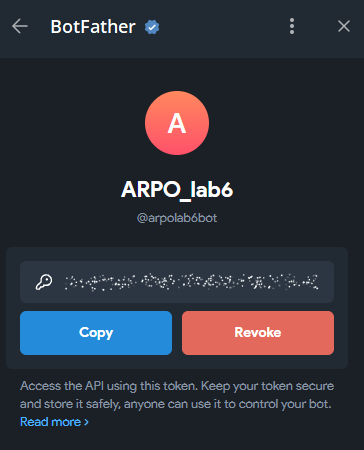
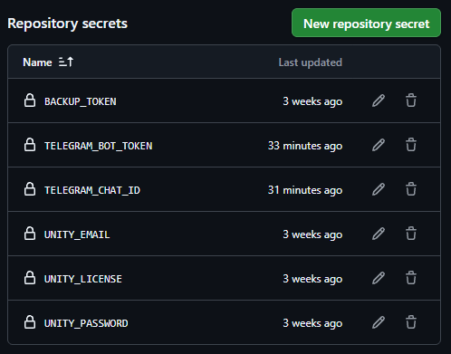
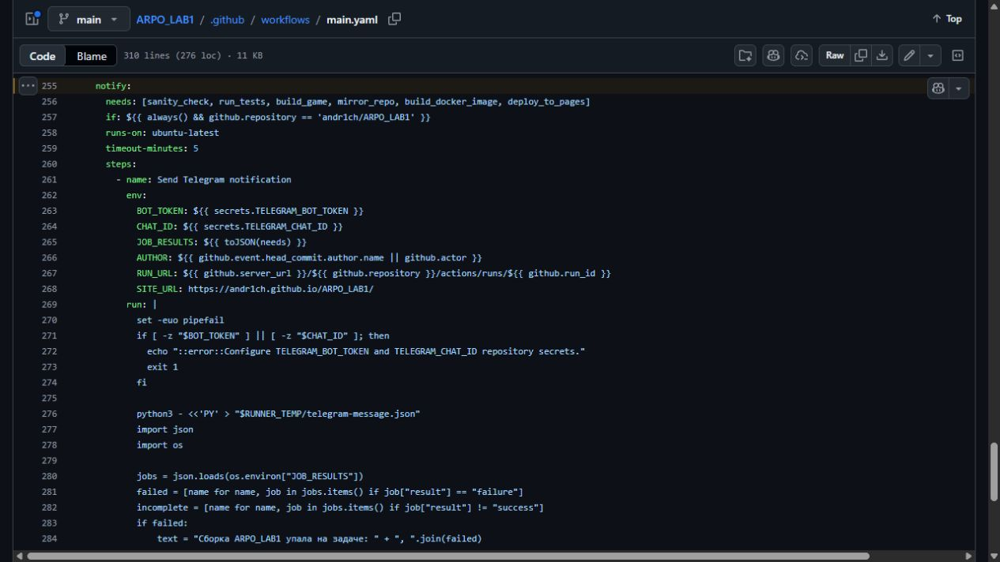
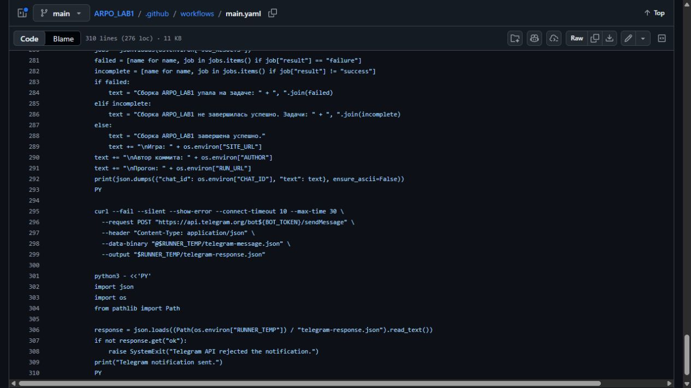
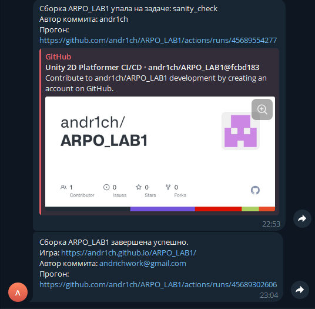

Порядок выполнения лабораторной работы 6

Шаг 1: Создание Telegram-бота и получение параметров доступа

Шаг 2: Добавление секретов в репозиторий

Шаг 3: Добавление задачи уведомления в пайплайн

Шаг 4: Запуск и проверка обоих сценариев

